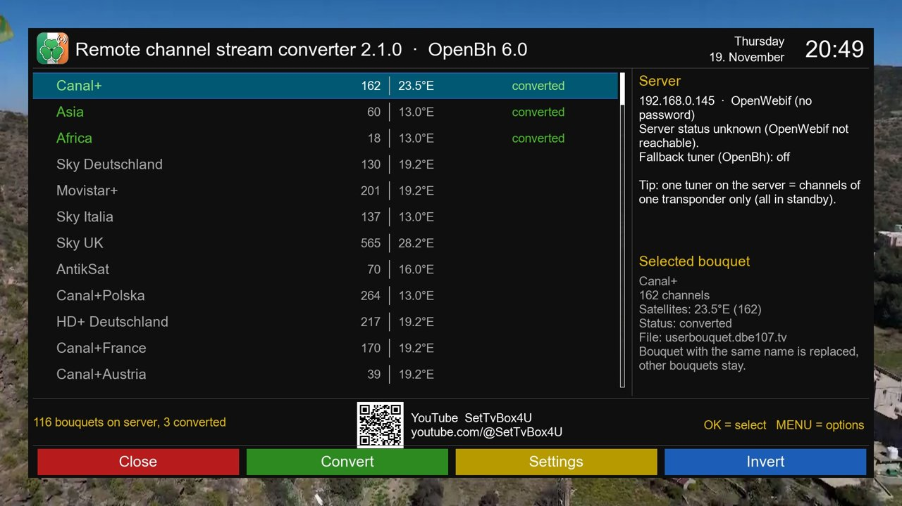
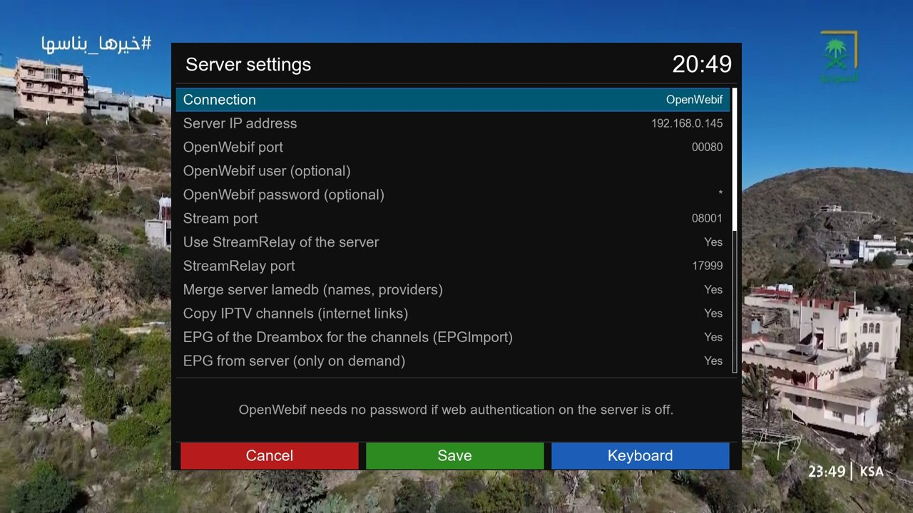
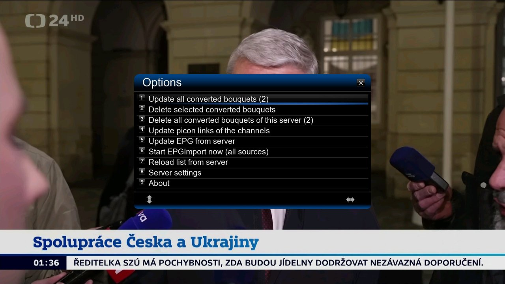
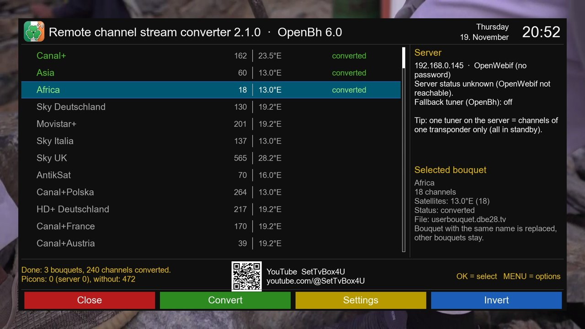
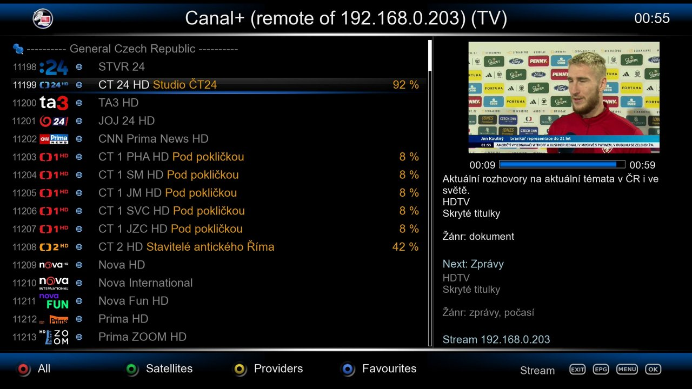
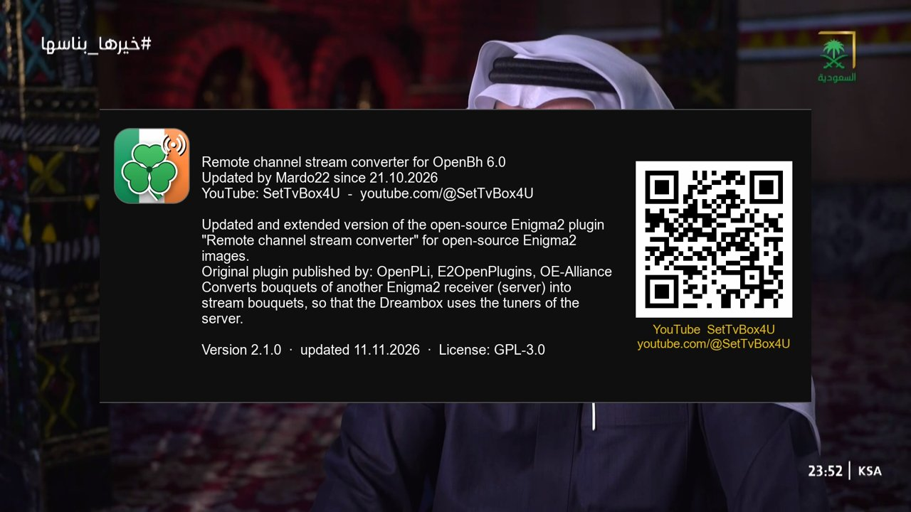

# Remote channel stream converter 2.1.2 for open-source Enigma2 images

> [!CAUTION]
> **⚠️ We do not support illegal viewing, sharing or distribution of TV channels. This plugin and all our videos are for educational purposes only.**<br>
> **⚠️ نحن لا ندعم المشاهدة أو المشاركة أو النشر غير القانوني للقنوات التلفزيونية. هذه الإضافة وجميع فيديوهاتنا لأغراض تعليمية فقط.**<br>
> **⚠️ Nepodporujeme nelegálne sledovanie, zdieľanie ani šírenie TV kanálov. Plugin aj všetky naše videá slúžia len na vzdelávacie účely.**<br>
> **⚠️ Wir unterstützen kein illegales Ansehen, Teilen oder Verbreiten von TV-Sendern. Dieses Plugin und alle unsere Videos dienen nur Lernzwecken.**<br>
> **⚠️ Ní thacaímid le féachaint, comhroinnt ná scaipeadh mídhleathach cainéal teilifíse. Is chun críocha oideachais amháin atá an breiseán seo agus ár bhfíseáin go léir.**

🌐 **English** · [العربية – Arabic](README_AR.md) · [Slovensky (PDF)](docs/RCSC-2.1.0_open-source_Navod_SK.pdf)
· DreamOS version: [RemoteChannelStreamConverter-DreamOS](https://github.com/Mardo22/RemoteChannelStreamConverter-DreamOS)

**Watch the channels of another receiver in your network – with picons and EPG.** This is our update of the
"Remote channel stream converter" plugin for **open-source Enigma2 images with Python 3** (OE-Alliance based:
OpenATV, OpenBH, PurE2 and similar). It turns the bouquets of a second receiver (the *server*, for example a Vu+ with the
satellite cable) into stream bouquets on this receiver. The channels then play through the tuners of the server.

The image feeds contain an old version of this plugin (V1.0, FTP only). Our update replaces it.

**Current version: 2.1.2** (27.11.2026) – one package for Python 3.13 and 3.14 (the package contains only source code,
the image compiles it itself).

📺 YouTube channel: **[SetTvBox4U – youtube.com/@SetTvBox4U](https://www.youtube.com/@SetTvBox4U)**
🎬 Trailer (Vu+ Ultimo 4K, OpenBlackHole): [https://youtu.be/1WwbSd642tw](https://youtu.be/1WwbSd642tw) · full video guide for DreamOS: [https://youtu.be/CLJeFTDPoZw](https://youtu.be/CLJeFTDPoZw)
📄 User guide on Vu+ Ultimo 4K / OpenBH 6.0 (PDF): [English](docs/RCSC-2.1.0_open-source_User-Guide_EN.pdf) · [Arabic – العربية](docs/RCSC-2.1.0_open-source_User-Guide_AR.pdf) · [Slovak – Slovensky](docs/RCSC-2.1.0_open-source_Navod_SK.pdf)
📄 Old feed plugin vs. our update (PDF): [English](docs/RCSC-2.1.0_old-vs-new_OpenBH_EN.pdf) · [Arabic](docs/RCSC-2.1.0_old-vs-new_OpenBH_AR.pdf) · [Slovak](docs/RCSC-2.1.0_old-vs-new_OpenBH_SK.pdf)

## Screenshots (Vu+ Ultimo 4K, OpenBH 6.0)

| Plugin window | Server settings |
|---|---|
|  |  |
| **Options (MENU)** | **Converted bouquets** |
|  |  |
| **Channel list – stream from the server** | **About** |
|  |  |

## What is new compared to the feed plugin
- Connection over **OpenWebif without a password** (FTP with password still possible).
- Server status at a glance: model, image, standby / current channel, busy tuners.
- Bouquet list with number of channels and satellites; converted bouquets are marked.
- Summary after converting (bouquets, channels, picons, EPG) instead of a window that just closes.
- Options menu: update all, delete selected / all converted bouquets, picon links, EPG from server, EPGImport, reload.
- IPTV channels of the server are copied with their internet links; StreamRelay channels go to port 17999.
- Picons: links for the converted channels and missing picons copied from the server.
- EPG: mapping for EPGImport and EPG from the server on demand.
- Current channel names from the server, Full HD window, title with the name of the image.
- **Online update** (since 2.1.1): when the plugin is opened it checks GitHub for a new version – you decide with OK or EXIT
  (option, MENU "Check for updates now").

## Tested
| Image | Python | Receiver | Result |
|---|---|---|---|
| OpenATV 8.0.1 | 3.14 | Dreambox Two | ✅ |
| PurE2 7.6 | 3.13 | Dreambox Two | ✅ |
| OpenBH 5.6.008 | 3.14 | Dreambox Two | ✅ |
| OpenBH 6.0.005 | 3.14 | Vu+ Ultimo 4K | ✅ |

Server: Vu+ Ultimo 4K with OpenBh 6.0. Streams tested in 1920×1080 (Asia 13°E, Canal+ 23.5°E).

## Installation
1. Copy `release/enigma2-plugin-extensions-rcsc-settvbox4u_2.1.2_all.ipk` to `/tmp` of the receiver.
2. In telnet / SSH:
   ```sh
   opkg remove enigma2-plugin-extensions-remotechannelstreamconverter   # old feed plugin, if installed
   opkg install /tmp/enigma2-plugin-extensions-rcsc-settvbox4u_2.1.2_all.ipk
   ```
3. Restart the GUI.

Bouquets created by the old feed plugin are recognised as converted.

## Usage
**Menu → Setup → Tuners & Scanning → Remote channel stream converter** (in the settings it can also be added to the
main menu, the plugin browser and the blue menu).
1. Yellow = settings: IP address of the server, green = save.
2. Select bouquets with **OK**, then **green (Convert)**.
3. **MENU** for update, delete, picons and EPG.

## Requirements
- Open-source Enigma2 image with Python 3 (OE-Alliance based).
- Server: Enigma2 receiver in the same network with OpenWebif (port 80) or FTP, streaming on port 8001.
- The receiver plays only what the server can tune (one tuner on the server = channels of one transponder).

## Build the package yourself
```sh
python build_ipk.py
```

## Credits
- Original plugin "Remote channel stream converter" – OpenPLi, E2OpenPlugins, OE-Alliance (GPL-3.0).
- Updates 1.1 – 2.1.1: **Mardo22 ([SetTvBox4U](https://www.youtube.com/@SetTvBox4U))**, 2026 – see [CHANGELOG.md](CHANGELOG.md).

## License
GNU General Public License v3.0 – see [LICENSE](LICENSE).

## Disclaimer
The plugin only converts the channel lists of your own receivers in your own network. It contains no channel lists,
no IPTV links and no keys. Use it only with services you are entitled to receive. No warranty.
