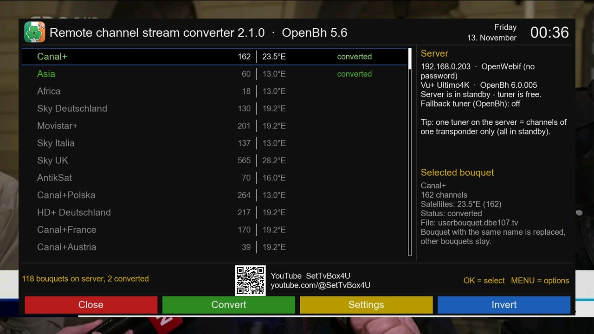
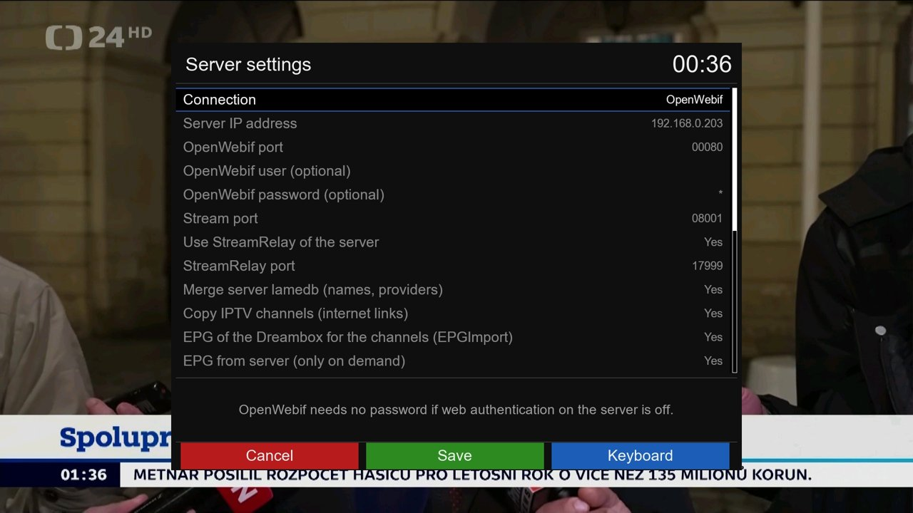
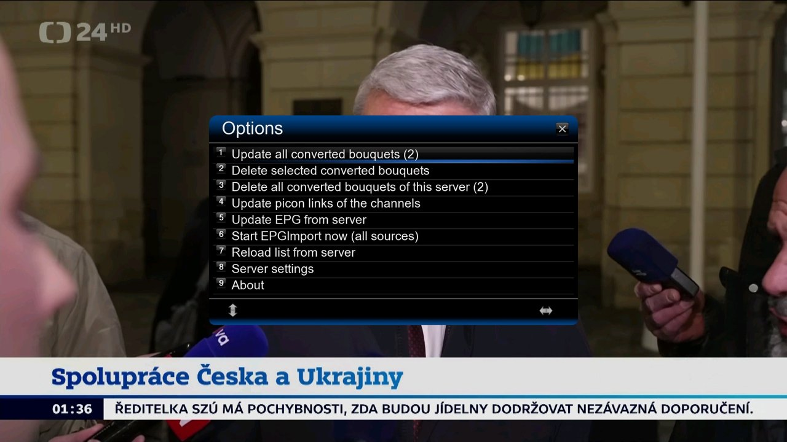
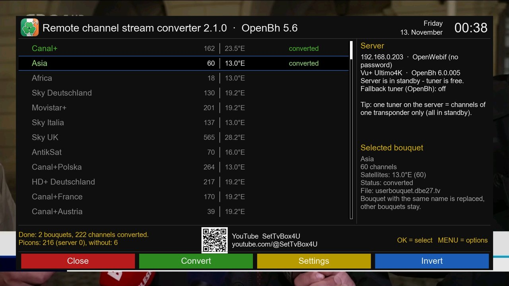
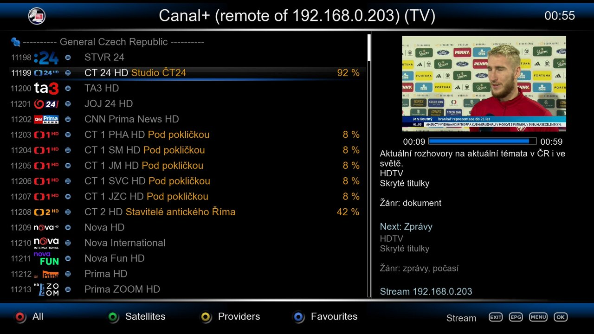
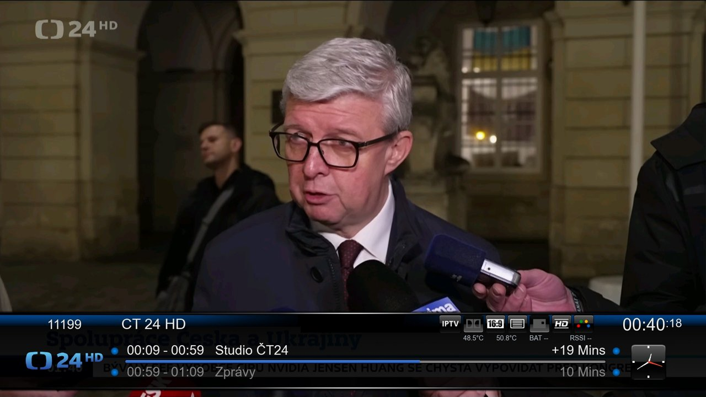

<div dir="rtl">

# Remote channel stream converter 2.1.0 لصور Enigma2 مفتوحة المصدر

🌐 [English](README.md) · **العربية** · [Slovensky (PDF)](docs/RCSC-2.1.0_open-source_Navod_SK.pdf) · [DreamOS](https://github.com/Mardo22/RemoteChannelStreamConverter-DreamOS)

**شاهد قنوات جهاز استقبال آخر في شبكتك – مع الصور و EPG.** هذا تحديثنا لإضافة «Remote channel stream converter» لصور
Enigma2 مفتوحة المصدر مع Python 3 (المبنية على OE-Alliance مثل OpenATV و OpenBH و PurE2). تحوّل الإضافة باقات جهاز
استقبال ثانٍ (الخادم، مثلاً Vu+ موصول بكابل الطبق) إلى باقات بث على هذا الجهاز، فتعمل القنوات عبر موالفات الخادم.

في خلاصات الصور نسخة قديمة من هذه الإضافة (V1.0، عبر FTP فقط). تحديثنا يحلّ محلها.

**الإصدار الحالي: 2.1.0** (11.11.2026) – حزمة واحدة لـ Python 3.13 و 3.14.

📺 قناة YouTube: **[SetTvBox4U](https://www.youtube.com/@SetTvBox4U)**
📄 دليل الاستخدام الأول (PDF): [العربية](docs/RCSC-2.1.0_open-source_User-Guide_AR.pdf) · [English](docs/RCSC-2.1.0_open-source_User-Guide_EN.pdf) · [Slovensky](docs/RCSC-2.1.0_open-source_Navod_SK.pdf)
📄 الإضافة القديمة مقابل تحديثنا (PDF): [العربية](docs/RCSC-2.1.0_old-vs-new_OpenBH_AR.pdf) · [English](docs/RCSC-2.1.0_old-vs-new_OpenBH_EN.pdf)

## صور الشاشة (OpenBH 5.6)

| نافذة الإضافة | إعدادات الخادم |
|---|---|
|  |  |
| **قائمة الخيارات (MENU)** | **الباقات المحوّلة** |
|  |  |
| **قائمة القنوات مع الصور و EPG** | **شريط المعلومات** |
|  |  |

## الجديد مقارنة بإضافة الخلاصة
- اتصال عبر **OpenWebif بدون كلمة مرور** (و FTP مع كلمة مرور ما زال ممكناً).
- حالة الخادم مباشرة: الموديل، الصورة، الاستعداد أو القناة الحالية، الموالفات المشغولة.
- قائمة الباقات مع عدد القنوات والأقمار، والباقات المحوّلة معلّمة.
- ملخص بعد التحويل (الباقات، القنوات، الصور، EPG) بدلاً من نافذة تُغلق بدون رسالة.
- قائمة خيارات: تحديث الكل، حذف المختارة أو الكل، روابط الصور، EPG من الخادم، EPGImport، إعادة التحميل.
- قنوات IPTV من الخادم تُنسخ مع روابطها، وقنوات StreamRelay تعمل على المنفذ 17999.
- الصور: روابط للقنوات المحوّلة ونسخ الصور الناقصة من الخادم.
- EPG: ربط مع EPGImport و EPG من الخادم عند الطلب.

## تم الاختبار
| الصورة | Python | الجهاز | النتيجة |
|---|---|---|---|
| OpenATV 8.0.1 | 3.14 | Dreambox Two | ✅ |
| PurE2 7.6 | 3.13 | Dreambox Two | ✅ |
| OpenBH 5.6.008 | 3.14 | Dreambox Two | ✅ |
| OpenBH 6.0.005 | 3.14 | Vu+ Ultimo 4K | ✅ |

الخادم: Vu+ Ultimo 4K مع OpenBh 6.0. البث بدقة 1920×1080.

## التثبيت
1. انسخ الملف `release/enigma2-plugin-extensions-rcsc-settvbox4u_2.1.0_all.ipk` إلى `/tmp` في الجهاز.
2. عبر telnet أو SSH:

</div>

```sh
opkg remove enigma2-plugin-extensions-remotechannelstreamconverter
opkg install /tmp/enigma2-plugin-extensions-rcsc-settvbox4u_2.1.0_all.ipk
```

<div dir="rtl">

3. أعد تشغيل الواجهة.

## الاستخدام
**Menu ← Setup ← Tuners & Scanning ← Remote channel stream converter**
1. الأصفر = الإعدادات: عنوان IP للخادم، الأخضر = حفظ.
2. اختر الباقات بزر **OK** ثم **الأخضر (Convert)**.
3. زر **MENU** للتحديث والحذف والصور و EPG.

## الترخيص
GNU General Public License v3.0 – راجع [LICENSE](LICENSE).

## تنبيه
الإضافة تحوّل فقط قوائم القنوات لأجهزتك في شبكتك. لا تحتوي على قوائم قنوات ولا روابط IPTV ولا مفاتيح.

</div>
